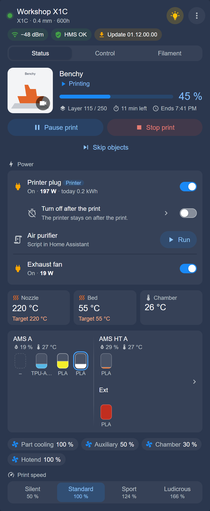
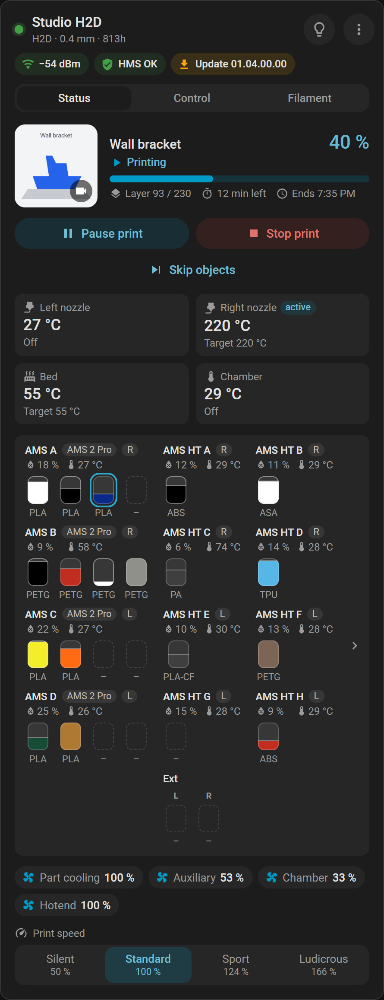
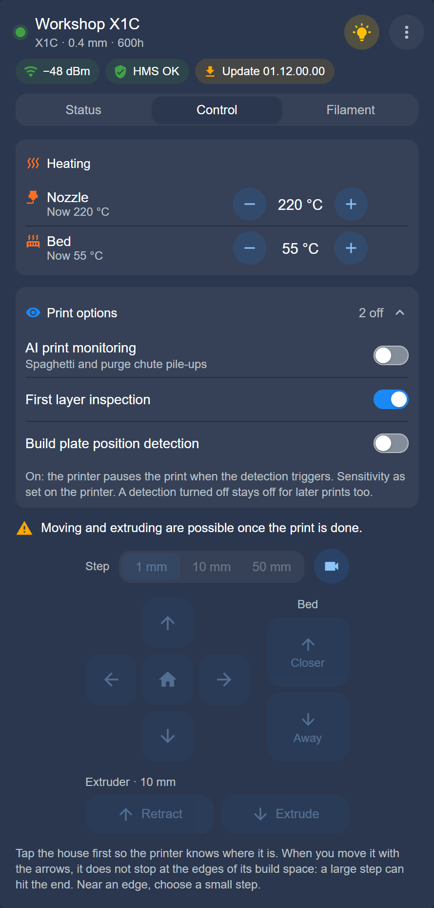
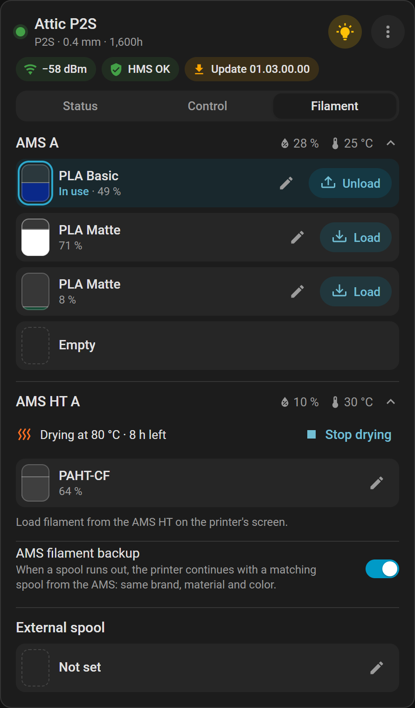

<p align="center">
  
</p>

<h1 align="center">BamBuddy – Home Assistant Integration</h1>

<p align="center">
  <a href="https://my.home-assistant.io/redirect/marketplace_repository/?owner=Spegeli&repository=hacs_bambuddy&category=integration"></a>
</p>

<p align="center">
  <a href="https://github.com/hacs/integration"></a>
  <a href="https://github.com/Spegeli/hacs_bambuddy/releases/latest"></a>
  <a href="https://github.com/Spegeli/hacs_bambuddy/blob/main/LICENSE"></a>
  <a href="https://www.home-assistant.io/"></a>
</p>

<p align="center">
  💬 Questions and discussion: <a href="https://community.home-assistant.io/t/1029750">Home Assistant forum</a> · <a href="https://www.reddit.com/r/BambuLab/comments/1xim2qw/bambuddy_integration_for_home_assistant_every/">r/BambuLab on Reddit</a>
</p>

A custom <a href="https://www.home-assistant.io/">Home Assistant</a> integration for **BamBuddy**: the status, camera and controls of your Bambu Lab printers on your dashboard.

[BamBuddy](https://github.com/maziggy/bambuddy) is a self-hosted command center for Bambu Lab 3D printers. The integration talks only to your own BamBuddy server, through its REST API and its live connection; it uses no cloud.

*This is the integration, not the app: it connects Home Assistant to a BamBuddy server — on any machine, or inside Home Assistant with the [BamBuddy app](https://github.com/Spegeli/homeassistant-app-bambuddy).*

📚 Everything in detail, for the latest release: the [documentation](https://github.com/Spegeli/hacs_bambuddy/blob/main/documentation/README.md).

> [!IMPORTANT]
> **Updating from a date version (2026.05.17 or older)?** Read [Upgrading from a date version](https://github.com/Spegeli/hacs_bambuddy/blob/main/documentation/updating.md#upgrading-from-a-date-version) first — it may need a new API key and cannot be undone.

---

## ✨ Features

- **Printer status** — the print with its progress and times, temperatures, fans, HMS messages
- **AMS and spools** — every AMS unit as its own device; filament by vendor and profile, as in Bambu Studio; drying; BamBuddy's spool inventory
- **Control** — pause, stop and skip objects; speed, temperatures, fans, the light, ventilation; the printer's own AI detection
- **Camera** — live view and snapshots through BamBuddy
- **Dashboard card** — one card per printer, shipped with the integration, arranged as you like
- **Smart plugs** — switch them, see their power and energy, turn the printer off after a print
- **Maintenance and updates** — the printer's tasks, a connection check, new BamBuddy and firmware versions
- **Local and live** — no cloud, any number of printers, and most changes show as soon as BamBuddy hears of them

New to a word such as AMS, HMS or K profile? The [Glossary](https://github.com/Spegeli/hacs_bambuddy/blob/main/documentation/glossary.md) explains it.

---

## 📸 Screenshots

*The dashboard card that comes with the integration, on simulated printers.*

<p>
  
  
  
  
</p>

---

## 📋 Requirements

- Home Assistant **2025.5** or newer
- A running [BamBuddy](https://github.com/maziggy/bambuddy) server, version **1.2.5.7** or newer, that Home Assistant can reach — with your printers added in BamBuddy first (see [BamBuddy's documentation](https://wiki.bambuddy.cool)): the integration shows what BamBuddy manages
- A BamBuddy API key with **Read Status**, **Control Printer** and **Manage Maintenance**; **Manage Inventory** is optional (see **Create an API key** under Configuration)
- For the controls: the printer's **developer LAN mode** on — without it the printer ignores the commands BamBuddy passes on (see [Troubleshooting](https://github.com/Spegeli/hacs_bambuddy/blob/main/documentation/troubleshooting.md#printers-and-controls))
- For the installation: the Marketplace (formerly HACS), part of Home Assistant from 2026.11 on, or [HACS](https://hacs.xyz) on an older one

---

## 🧩 Home Assistant App

The [BamBuddy app](https://github.com/Spegeli/homeassistant-app-bambuddy) runs BamBuddy itself on Home Assistant OS, installed and updated like any other app. With the app, set up the integration with the address you open BamBuddy with, such as `http://homeassistant.local:8000` (not `localhost`).

---

## 📦 Installation

You need a BamBuddy API key for the setup: see **Create an API key** under Configuration. Already on BamBuddy's page in the Marketplace? Choose **Install** there. Otherwise, follow the steps for your Home Assistant.

### Marketplace (formerly HACS)

1. In Home Assistant, open **Settings → Marketplace**. The first time, tick **I understand the risks and agree** and choose **Continue**.
2. Choose **Add from link**, enter `Spegeli/hacs_bambuddy` or the full address under **GitHub link** and choose **Add** — or open [BamBuddy in your Marketplace](https://my.home-assistant.io/redirect/marketplace_repository/?owner=Spegeli&repository=hacs_bambuddy&category=integration). Adding a repository needs a GitHub connection: without one, the Marketplace asks for it first and gives you a code to enter on GitHub. The connection only reads public information, and you can revoke it in your GitHub settings.
3. Open **BamBuddy** on the **Browse** tab, under **New** or **Available**, or search for it. Choose **Install**, then **Install** in the dialog that warns "You install this at your own risk".

No restart needed: the setup opens by itself.

<details>
<summary>Home Assistant before 2026.11: HACS</summary>

[](https://my.home-assistant.io/redirect/hacs_repository/?owner=Spegeli&repository=hacs_bambuddy&category=Integration)

The badge opens BamBuddy in your HACS. Without it:

1. In Home Assistant, open **HACS**.
2. Select the three dots `⋮` in the top right corner and choose **Custom repositories**.
3. Paste the repository URL:
   ```text
   https://github.com/Spegeli/hacs_bambuddy
   ```
4. Select **Integration** as the **Type** and select **Add**.
5. Find **BamBuddy** in the list and select **Download**.
6. Restart Home Assistant.

</details>

### Manual installation

1. Download the `Source code (zip)` of the latest release from the [Releases](https://github.com/Spegeli/hacs_bambuddy/releases) page.
2. Copy its `custom_components/bambuddy` folder to `/config/custom_components/bambuddy/`.
3. Restart Home Assistant.

### Updates and betas

New versions show under **Settings → Updates** and take a restart of Home Assistant. Betas and other versions: [Updating](https://github.com/Spegeli/hacs_bambuddy/blob/main/documentation/updating.md).

---

## ⚙️ Configuration

### Create an API key

1. In BamBuddy, open **Settings → API Keys** and choose **Create Key**.
2. Give it a name, such as `Home Assistant`, and tick the permissions listed after these steps.
3. Copy the key: BamBuddy shows it only once.

**Required** — the integration refuses a key that lacks one:

- **Read Status**: everything Home Assistant shows, the camera included.
- **Control Printer**: the controls — print, speed, temperatures, fans, light, ventilation, moving the axes, filament, drying, HMS answers, the AI detection and switching smart plugs.
- **Manage Maintenance**: marking maintenance done.

**Optional:**

- **Manage Inventory**: assigning spools of BamBuddy's inventory to a slot from Home Assistant; without it, the spool BamBuddy assigned to a slot still shows.

BamBuddy cannot add a permission to an existing key: if one is missing, create a new key and enter it in Home Assistant.

BamBuddy enforces the permissions only while its authentication is on (**Settings → Authentication**). With it off, anyone who can reach BamBuddy can control your printers, so turn it on before you create the key. The integration checks the key either way: see [BamBuddy's authentication](https://github.com/Spegeli/hacs_bambuddy/blob/main/documentation/configuration.md#bambuddys-authentication).

### Set up the integration

1. After an install from the Marketplace the setup is already open. Otherwise go to **Settings → Devices & services → Add integration** and search for **BamBuddy**.
2. Enter BamBuddy's address — the one you open it with in your browser, such as `192.168.1.20:8000` or `https://bambuddy.example.com` — and the API key. **Verify SSL certificate** only matters for an `https` address; turn it off for a self-signed certificate.
3. Choose your printers: all are selected. Each becomes a device named as in BamBuddy, its AMS units devices of their own.
4. If Home Assistant offers **Name and assign**, choose **Skip and finish**, or pick areas first. The names come from BamBuddy, and a name given in Home Assistant goes back: rename a printer in BamBuddy.

Next: your printers are under **Settings → Devices & services → BamBuddy**; add the [dashboard card](https://github.com/Spegeli/hacs_bambuddy/blob/main/documentation/dashboard-card.md#add-the-card) to see and control them.

Adding and removing printers, another address or key, live updates: [Configuration](https://github.com/Spegeli/hacs_bambuddy/blob/main/documentation/configuration.md).

---

## 🃏 Dashboard card

The integration brings its own card: one per printer, with its status, camera, temperatures, AMS colors and controls. Nothing else to install. Pictures of it are in the section **Screenshots**.

> [!NOTE]
> After installing or updating the integration, reload the browser page (twice if the card is still missing). In the companion app: **Settings → Companion app → Troubleshooting → Reset frontend cache**.

1. Open a dashboard, choose **Edit dashboard** (✏️), then **Add card**. On a dashboard Home Assistant fills automatically, it may first ask you to take control.
2. Switch to **By card**, search for **BamBuddy** and choose **BamBuddy printer**.
3. Check the printer: the editor starts with one already chosen. The other options can stay as they are.

Every tab, chip and option: [Dashboard card](https://github.com/Spegeli/hacs_bambuddy/blob/main/documentation/dashboard-card.md).

---

## 🤖 Automation examples

A message with the job's name when a print finishes, or fails — a print you stop yourself counts as failed. It fires only when the status changes from `printing` or `paused`. So a restart or a printer back from offline sends nothing.

Paste it under **Settings → Automations & scenes → Create automation → ⋮ → Edit in YAML**, then put in your entity IDs (your printer's device page lists them) and your phone's notify action.

```yaml
alias: BamBuddy print finished or failed
triggers:
  - trigger: state
    entity_id: sensor.x1c_00m00a000000001_print_status
    from: [printing, paused]
    to: [finished, failed]
actions:
  - action: notify.mobile_app_your_phone
    data:
      title: "{{ 'Print done' if trigger.to_state.state == 'finished' else 'Print failed' }}"
      message: "{{ states('sensor.x1c_00m00a000000001_current_print') }}"
```

Four more, for HMS messages, the chamber light, wet filament and a printer lost during a print: [Automations](https://github.com/Spegeli/hacs_bambuddy/blob/main/documentation/automations.md).

---

## 📚 Documentation

The [overview](https://github.com/Spegeli/hacs_bambuddy/blob/main/documentation/README.md) says what each page holds:

- **Set up:** [Configuration](https://github.com/Spegeli/hacs_bambuddy/blob/main/documentation/configuration.md), [Printers](https://github.com/Spegeli/hacs_bambuddy/blob/main/documentation/printers.md)
- **Use:** [Dashboard card](https://github.com/Spegeli/hacs_bambuddy/blob/main/documentation/dashboard-card.md), [AMS and filament](https://github.com/Spegeli/hacs_bambuddy/blob/main/documentation/ams-and-filament.md), [Spool inventory](https://github.com/Spegeli/hacs_bambuddy/blob/main/documentation/spool-inventory.md), [Chamber](https://github.com/Spegeli/hacs_bambuddy/blob/main/documentation/chamber.md), [Smart plugs](https://github.com/Spegeli/hacs_bambuddy/blob/main/documentation/smart-plugs.md), [Automations](https://github.com/Spegeli/hacs_bambuddy/blob/main/documentation/automations.md)
- **Look up:** [Entities](https://github.com/Spegeli/hacs_bambuddy/blob/main/documentation/entities.md), [Actions](https://github.com/Spegeli/hacs_bambuddy/blob/main/documentation/actions.md), [Glossary](https://github.com/Spegeli/hacs_bambuddy/blob/main/documentation/glossary.md)
- **Help:** [How it works](https://github.com/Spegeli/hacs_bambuddy/blob/main/documentation/how-it-works.md), [Troubleshooting](https://github.com/Spegeli/hacs_bambuddy/blob/main/documentation/troubleshooting.md), [Updating](https://github.com/Spegeli/hacs_bambuddy/blob/main/documentation/updating.md)

---

## 🔧 Troubleshooting

**BamBuddy cannot be reached.**
Use the address you open BamBuddy with in your browser, including the port. With BamBuddy running as a Home Assistant app, use the host's address and the port the app shows, not `localhost`.

**The setup does not accept the key.**
Check that you pasted all of it. Where the form shows the three permissions, the key lacks those marked ✗: create a new one with all three.

**A button or a temperature does nothing on the printer.**
Turn on the printer's developer LAN mode (the *Developer mode* entity shows it) — see BamBuddy's [Enabling Developer Mode](https://wiki.bambuddy.cool/getting-started/#enabling-developer-mode). It takes the printer off Bambu's cloud, and its access code changes: enter the new one in BamBuddy.

**The card is missing in "Add card", or shows "Custom element doesn't exist".**
Reload the page (twice), or reset the companion app's frontend cache. The card needs no entry under *Resources*.

**Everything of a printer is unavailable.**
With *Print status* `offline`, BamBuddy lost the printer: the card's *Check connection* says why. If *Print status* is unavailable too, BamBuddy does not answer or no longer accepts the key: look under **Settings → Repairs**.

More, and what to add to a bug report (**⋮ → Download diagnostics** on the BamBuddy entry): [Troubleshooting](https://github.com/Spegeli/hacs_bambuddy/blob/main/documentation/troubleshooting.md).

---

## ⬆️ Upgrading from a date version

2.0.0 is a new integration under the old name. It needs a new API key where the stored one lacks a permission or BamBuddy does not know it; a 1.x key usually has Read Status only. It also changes values your automations may compare. Read [Upgrading from a date version](https://github.com/Spegeli/hacs_bambuddy/blob/main/documentation/updating.md#upgrading-from-a-date-version) before you update.

---

## 🗑️ Removal

1. Remove the BamBuddy printer cards from your dashboards: without the integration they show "Custom element doesn't exist".
2. Go to **Settings → Devices & services → BamBuddy** and delete the entry with **⋮ → Delete**. Its devices, their entities and the stored API key go with it.
3. After an install from the Marketplace, Home Assistant asks at the last entry **Also uninstall BamBuddy?**: choose **Uninstall**. If you chose **Keep**, open **BamBuddy** on the Marketplace's **Installed** tab and choose **⋮ → Uninstall**. Then restart Home Assistant: **Settings → Repairs** offers it.
4. Optional: delete the API key in BamBuddy (**Settings → API Keys**) if nothing else uses it.
5. With HACS: remove **BamBuddy** there (its **⋮** menu → **Remove**). Installed manually: delete the `/config/custom_components/bambuddy/` folder. Then restart Home Assistant.

The recorded history of the removed entities stays until the recorder purges it, after 10 days by default (the recorder's `purge_keep_days`). Long-term statistics stay until you delete them under **Settings → Tools → Statistics** (before Home Assistant 2026.8: **Developer tools → Statistics**).

---

## ⚖️ Disclaimer

- **Not a BamBuddy or Bambu Lab product.** This integration is an independent community project. Neither the BamBuddy project nor Bambu Lab develops, endorses or supports it, and their support cannot help with it — use the [GitHub issue tracker](https://github.com/Spegeli/hacs_bambuddy/issues) instead. Problems with BamBuddy itself belong to [its own project](https://github.com/maziggy/bambuddy/issues).
- **Names and logos.** BamBuddy and its logo belong to the BamBuddy project; Bambu Lab and the names of its printers are trademarks of their owner. They appear here only to name the software and the printers the integration connects to.
- **Status for information only.** The integration shows what BamBuddy's REST API returns; values can be delayed or differ from BamBuddy's own interface and the printer's display.
- **Use at your own risk.** The software is provided as is, without warranty, under the MIT License. Its controls act on a real printer: pause, stop and the other commands reach it through BamBuddy — mind that in automations.

---

## 📜 License

This project is licensed under the **MIT License** — see the [LICENSE](https://github.com/Spegeli/hacs_bambuddy/blob/main/LICENSE) file for details. It covers this project's code and documentation, not BamBuddy's name and logo (`.github/readme/logo.png` and `custom_components/bambuddy/brand/`), which belong to the BamBuddy project (see **Disclaimer**).
