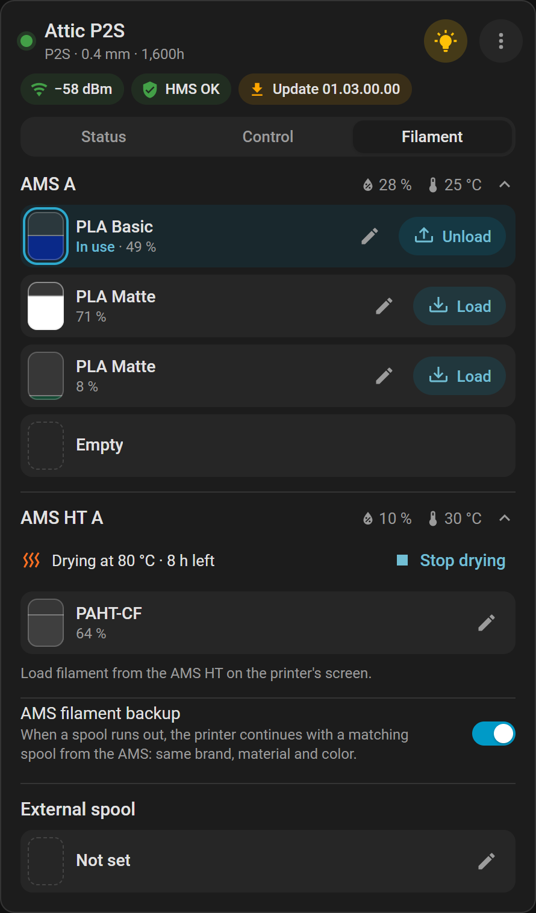
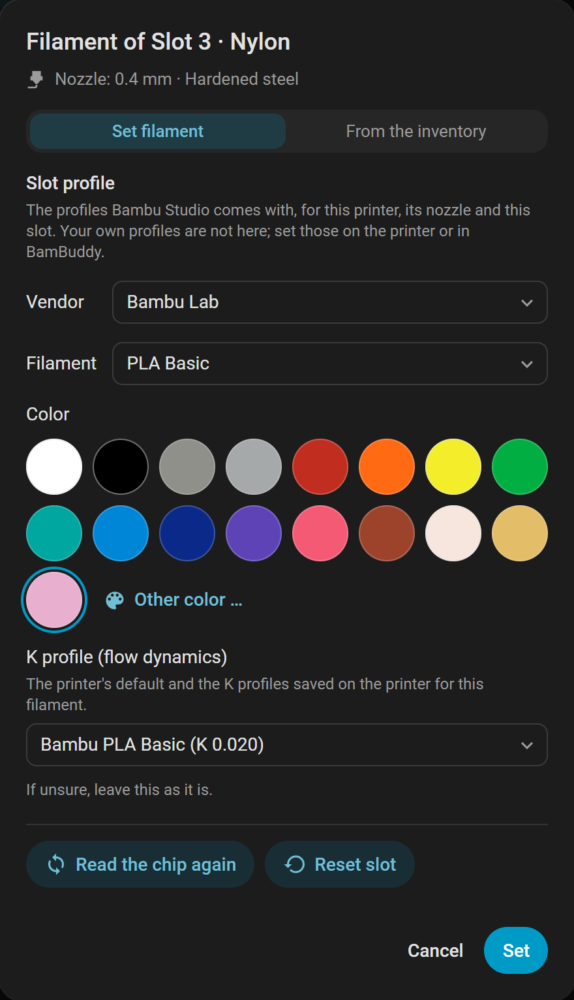

# AMS and filament

Load, set and dry filament from the card's Filament tab.

[← Documentation](README.md)

**Needs:** an [AMS](glossary.md#ams) or an [external spool](glossary.md#external-spool). The same can be done with [actions](actions.md#filament-and-slots). Spools from BamBuddy's inventory have [a page of their own](spool-inventory.md).

## The Filament tab

Each AMS unit shows its name, humidity and temperature, with its [slots](glossary.md#slot) below. On two-nozzle printers it also names the nozzle it feeds (L or R).

From three units on, each unit shows only its head, colors and drying at first; a tap on the head shows its slots. The option `ams_folding` changes that.

| A slot shows | Meaning |
|---|---|
| The filament's name | What the slot is set to, and its color |
| A percentage | What is left: the AMS's estimate for a Bambu Lab spool with its chip, or [the inventory spool's](spool-inventory.md#what-the-card-shows) figure with its grams |
| **In use** | It feeds the printer now; a ring marks it |
| **Empty** | No spool sits in the slot |
| **Not set** | A spool sits there, but nothing describes it |
| A second name | [The spool from BamBuddy's inventory](spool-inventory.md#what-the-card-shows) |

- Without a chip the AMS cannot estimate what is left; an inventory spool brings its own figure.
- An [AMS HT](glossary.md#ams-ht) has one slot, the H3C's [AMS 3H](glossary.md#ams-3h) nine.
- An [AMS Lite](glossary.md#ams-lite) has no humidity or temperature.

## Load and unload

1. In the Filament tab, tap **Load** on a filled slot, or **Unload** on the slot in use.
2. Confirm. On two-nozzle printers the question names the nozzle.

To load, the printer heats the nozzle, unloads the current filament and loads the new one. This takes a few minutes.

| You cannot load or unload | Why |
|---|---|
| While a print runs | Pause the print first |
| During a filament change | Wait until it is done |
| From an AMS HT, with BamBuddy before 1.3.0 | Only BamBuddy 1.3.0 and newer load from it: update BamBuddy, or load on the printer's screen |
| From an H3C's external input (*External 1–9*) | BamBuddy 1.3.1 does not load from them: load on the printer's screen |
| An AMS slot through a Filament Track Switch | **Load** is refused, as the load must name its nozzle: load on the printer or in BamBuddy |

On a printer with a [Filament Track Switch](glossary.md#filament-track-switch), the external spools load as usual.

### In a paused print

The tab says you can change the filament now, and offers **Resume print**. The print stays paused until you resume it, so resume once the new filament is in.

If the printer paused for a fault, deal with its message first. Its [HMS message](dashboard-card.md#hms-messages) says what happened.

## Set a filament

Set a filament for a spool without an [RFID chip](glossary.md#rfid-chip), as the printer's screen asks you to after a spool goes in. A Bambu Lab spool with its chip tells the printer by itself.

1. Tap the ✏️ on the slot. Below the title the dialog names the nozzle that feeds the slot.
2. Choose the **Vendor**, then the **Filament**.
3. Choose a **Color**, or **Other color …**.
4. Leave the [K profile](#k-profiles) as it is if unsure.
5. Choose **Set**.

What it changes:

- **A new color alone** keeps the slot's profile and K value.
- **A new filament** takes its Bambu Studio profile. The K field moves to its first saved K profile, else the printer's default.
- **During a print:** the slot a running print feeds can be set too, unless it holds a chip spool. The dialog warns that it changes mid-print.
- **An empty AMS slot** cannot be set: put the spool in first.

### Why a filament is not in the list

The list holds the [filament profiles](glossary.md#filament-profile) [Bambu Studio](glossary.md#bambu-studio) comes with: Bambu Lab, Generic, Polymaker, Overture, SUNLU and eSUN. It is made for this printer, its nozzle and this slot, and it comes with the integration. On an H3C it is made for the tool the slot or input feeds, whichever tool is on the toolhead.

| Missing | Why | What to do |
|---|---|---|
| Your own profile | Only Bambu Studio's are listed | Set it on the printer or in BamBuddy |
| TPU (all but *TPU for AMS*) in an AMS slot | Bambu Studio does not allow it in the AMS; only the A2L's AMS Lite takes it | Put it on an external spool, or use a *TPU for AMS* profile |
| Bambu's PET-CF, PA6-CF, PPS-CF or PPA-CF in an AMS slot | Bambu Studio does not allow them in the AMS; the H3C's AMS 3H takes all but PPA-CF | Put it on an external spool |
| 2.85 mm TPU | Only the H3C's TPU tool takes it | Set it on the input that feeds that tool (*External 8* as delivered) |
| A filament for another printer or nozzle size | Bambu Studio does not offer it here | Change the nozzle, or use another filament |
| A filament on one side only | Bambu Studio allows it on the other nozzle | Use a slot that feeds that nozzle |
| Most filaments on an H2D or H2D Pro with a TPU high-flow nozzle | That nozzle takes TPU only | Change the nozzle |
| Everything | Bambu Studio offers nothing for this slot and nozzle | Set a profile on the printer or in BamBuddy |

A slot set to a profile the list lacks shows **Keep the current profile** in the vendor field, and a line says what that profile is. Colors and K profiles can still be changed there.

### A spool without a chip says it has one

The dialog then offers only the slot's tools, and `bambuddy.set_filament` refuses. The printer may still remember the last spool: take the spool out until the slot shows empty, then put it back.

## K profiles

A K profile is a saved flow calibration ([K profile in the Glossary](glossary.md#k-profile)). The field **K profile (flow dynamics)** offers the printer's default and the profiles saved on the printer for this filament.

If unsure, leave it as it is. Until you save profiles of your own, the printer uses its default. They come from the flow dynamics calibration in Bambu Studio, or from BamBuddy.

The field can be chosen at once; the printer's own profiles join when it answers. BamBuddy asks up to three times, so that takes about 16 seconds at most.

| The dialog says | Meaning |
|---|---|
| Asking the printer for its K profiles … | Waiting for the answer |
| The printer does not answer at once. | Five seconds passed; BamBuddy asks again |
| No K profiles of your own are saved … | The printer has none for this nozzle diameter |
| The printer did not answer in time. | Close the dialog and open it once more |

Profiles are kept per nozzle diameter, and the dialog asks for the diameter of the nozzle that feeds the slot.

## Reset a slot or read its chip

Both are in the slot's ✏️ dialog, and wait for a running print. A paused print allows them.

| Tool | What it does | Limits |
|---|---|---|
| **Reset slot** | Clears the slot's material and color, after a question | Only for a slot that is set: not **Empty** or **Not set** |
| **Read the chip again** | The AMS reads the spool's chip anew | AMS slots only, and only while no filament is loaded |

A spool with a chip shows again once the AMS reads the chip. A reset also ends the slot's assignment in [BamBuddy's inventory](spool-inventory.md).

## Dry filament

The [AMS 2 Pro](glossary.md#ams-2-pro), the AMS HT and the [AMS 3H](glossary.md#ams-3h) can dry; their row in the Filament tab shows it. The AMS 3H dries two of its slots, its drying zone: the row names them, and the dialog suggests from their spools alone. Which printers start drying from here is in [Printers](printers.md#drying-from-home-assistant).

1. Tap **Dry** in the unit's row.
2. Check **Temperature** and **Duration**.
3. Choose **Start drying**.

The dialog suggests the gentlest temperature among the loaded spools, as hotter can soften a spool, and the longest time. Where the spools want different temperatures, it names them. Without advice it starts at 55 °C for 8 hours.

| Unit | Temperature | Duration |
|---|---|---|
| AMS 2 Pro | 45–65 °C | 1–24 h |
| AMS HT | 45–85 °C | 1–24 h |
| AMS 3H | 45–85 °C | 1–24 h |

**Stop drying** asks first. While it dries, the row shows the time left. It shows the temperature only for a drying started through BamBuddy or Home Assistant: BamBuddy does not learn the temperature of one started on the printer.

| What happens | Why | What to do |
|---|---|---|
| **Start and stop it on the printer's screen.** | The A1, A1 mini, P1P and P1S dry only from there; older firmware not from here | Use the printer's screen, or update it |
| The printer cannot dry while it prints | Its firmware does not allow it | Start the drying once the print is done |
| The countdown stands still | The printer still counts the unit as drying | Stop it on the printer or in BamBuddy, then start again |
| **Dry** waits | A filament change runs | Wait until it is done |
| Another reason from BamBuddy | The printer's own, such as its power or filament at the outlet | Follow what it says |

## Filament backup

The switch **AMS filament backup** sits below the units. When a spool runs out, the printer continues with a matching spool from the AMS: same brand, material and color ([Filament backup in the Glossary](glossary.md#filament-backup)).

- **Two nozzles:** only spools on the same side.
- **External spools** take no part.
- **State unknown:** BamBuddy cannot read it on the A1 and P1 series before BamBuddy 1.3.0. Turning it on or off works all the same.

## The external spool

The spool holder outside the AMS shows below the units; two-nozzle printers have a left and a right one. It has no chip reader, and BamBuddy never reports a spool on it, so it holds what you set.

- **Load** and **Unload** work as for a slot.
- **Set filament** needs no spool in place, and the list also holds what the AMS may not take.
- **Reset spool** clears its material and color.

The option `show_external_spool` hides it on a printer with an AMS. One the printer or its running job feeds from shows all the same.

## When a unit is replaced or moved

Each unit is a device known by its serial number. It keeps its device, entities and history wherever on the printer it is plugged in.

**Replaced:** a replacement unit with a serial of its own is a new device with its own IDs (an AMS Lite stays the same device while BamBuddy reports no serial). The old one stays with unavailable entities until you delete it; its device page offers Delete once the printer no longer reports it.

**Moved to another printer:** the unit is a new device there. Delete its old device first, and it gets the plain entity IDs; otherwise they end in `_2`.

**An AMS Lite that gets its serial:** BamBuddy 1.2.5.7 reports none for the AMS Lite, BamBuddy 1.3.0 does. Once yours does:

1. The BamBuddy entry reloads once, and its entities are unavailable for a few seconds.
2. The unit keeps its device and history, and its entity IDs take its serial.
3. **Settings → Repairs** lists the renamed IDs for your automations.
4. Choose **Done** there once they use the new IDs; the list goes with the notice.

IDs you changed yourself stay. The forms of the IDs are under [AMS units](entities.md#ams-units).

## See also

- [Spool inventory](spool-inventory.md)
- [AMS units per printer](printers.md#ams-units-per-printer)
- [AMS entities](entities.md#ams-units)
