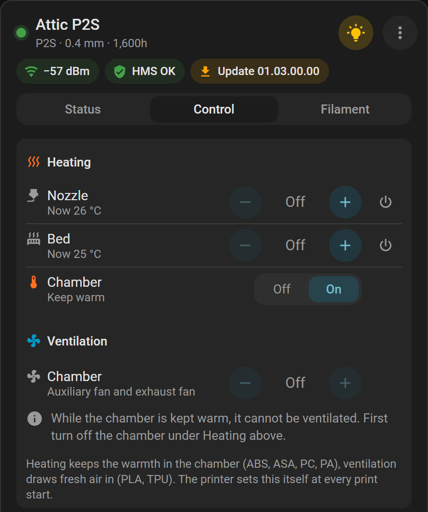

# Chamber

Heat or ventilate the chamber of a printer with an airduct, and see what locks what.

[← Documentation](README.md)

**Needs:** a printer with an [airduct](glossary.md#airduct): the P2S, the X2D or the H2 series. Other printers: [Chamber in Printers](printers.md#chamber).

Everything here is in the card's Control tab, under **Heating** and **Ventilation** (in the card editor, the section *Heating and ventilation*).

## Heat or ventilate

The airduct has two modes. The printer sets one itself at every print start.

| Mode | What it does | For |
|---|---|---|
| Heating | Keeps the warmth in the chamber | ABS, ASA, PC, PA |
| Cooling | Lets ventilation draw fresh air in | PLA, TPU |

The two exclude each other: see [Who locks whom](#who-locks-whom).

## Heating

The chamber's row under **Heating** has − and + in steps of 5 and a power switch. It starts at 40 °C.

- A target above 0 sets the airduct to heating first, unless a print or a filament change keeps the mode it set.
- A running job may set the target again.
- The chamber's switch stays during a print: turning it off ends no print.

The P2S has no heater. Its row reads **Keep warm**, on or off; on puts the airduct in heating mode, which keeps the warmth in.

## Ventilating

The section **Ventilation** has a row **Chamber**, on or off, in steps of 10 %. It starts at 60 %, and names the fans it runs.

Turned on, it sets the airduct to cooling and runs [the printer's fans](#per-model) at one speed. The entity *Ventilation* does the same: 60 % unless you give a speed.

**Off** stops the fans in cooling mode. Outside cooling mode it sends nothing: the ventilation is off there already, and the fans do other work.

While the printer is in laser mode for its laser module, ventilating switches it to cooling. The card says so first.

## Who locks whom

Without a print or a filament change: to ventilate while the chamber heats, turn the chamber heater off first. To heat while ventilating, turn the ventilation off first. The same goes for **Keep warm**.

The locked row says why in a note. A lock never takes away the way off: a locked part that is on can still be turned off.

| Situation | Heating | Ventilating |
|---|---|---|
| No print, the chamber heats or is kept warm | On | Locked |
| No print, the chamber is ventilated | Locked | On |
| Print in cooling mode | Locked | Speed can be set; the printer may change it again |
| Print in heating or laser mode | Target can be set | Locked |
| Filament change in cooling mode | Locked | Can be set |
| Filament change in another mode | Target can be set | Locked |

**Keep warm** can be changed only without a print and a filament change.

### The entity *Airduct mode*

This select (Configuration) sets **Cooling** or **Heating** while no print and no filament change runs. *Laser mode* shows while the printer has set it for its laser module; only the printer sets it.

- **Cooling** is refused while the chamber heats.
- **Heating** is refused while the chamber is ventilated.

The entities refuse as the card locks; [When actions refuse](actions.md#when-actions-refuse) has the rest.

## Per model

What the chamber and its ventilation are on each model:

| Printer | Chamber | Ventilation runs | Outside cooling mode |
|---|---|---|---|
| H2S, H2D, H2C | Heater, up to 65 °C | [Exhaust fan](glossary.md#exhaust-fan) | The fan draws off a laser's fumes |
| H2D Pro | Heater, up to 65 °C, from BamBuddy 1.3.0 | Exhaust fan | The fan draws off a laser's fumes |
| X2D | Heater, up to 65 °C | Right [auxiliary fan](glossary.md#auxiliary-fan) and exhaust fan | The right fan filters |
| H3C | Heater, up to 65 °C | Exhaust fan | — |
| P2S | **Keep warm**, no heater | Auxiliary fan; with the External Exhaust Fan kit also its exhaust fan | The auxiliary fan circulates through the filter |

The X2D's right auxiliary fan and the P2S's kit join once BamBuddy reports them. An H2D Pro on BamBuddy 1.2.5.7 has no chamber target or chamber temperature: see [Known limitations](troubleshooting.md#known-limitations). Until BamBuddy reports the heater, its row reads **Keep warm**, as on the P2S.

The Status tab's chamber tile shows what the chamber does: its target, *Ventilation 60 %*, *Keep warm* or *Off*. A tap opens its target or sensor, or the ventilation while it runs.

## See also

- [Fans](printers.md#fans)
- [Temperature limits](printers.md#temperature-limits)
- [Fan entities](entities.md#fans)
