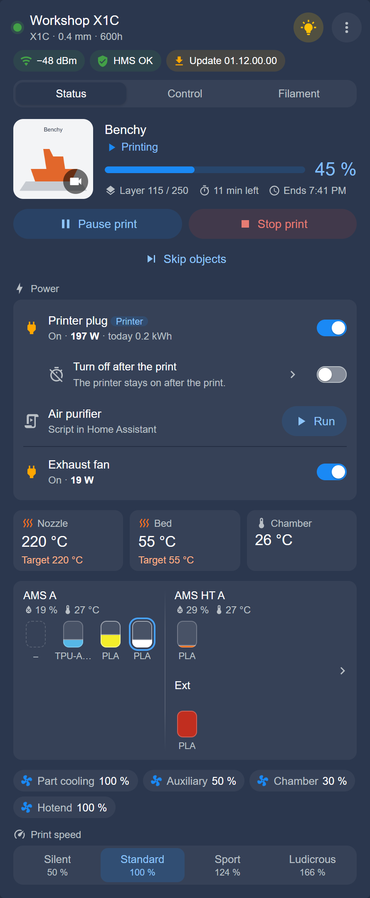
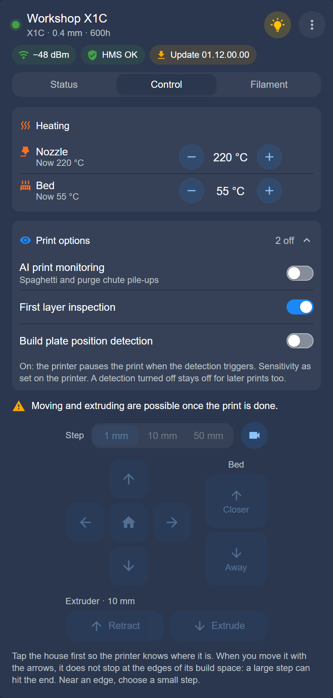

# Dashboard card

Add the BamBuddy printer card to a dashboard, and see what each part of it shows and does.

[← Documentation](README.md)

**On this page:** [Add the card](#add-the-card) · [Head and chips](#head-and-chips) · [Status](#status) · [Control](#control) · [Filament](#filament) · [Camera](#camera) · [HMS messages](#hms-messages) · [Maintenance](#maintenance) · [Offline](#offline) · [What asks first](#what-asks-first) · [Why a control is locked](#why-a-control-is-locked) · [Users who are not admins](#home-assistant-users-who-are-not-admins) · [Options](#options), with [The editor](#the-editor) and [Hide controls](#hide-controls)

The integration brings its own card: one per printer, with its status, camera, temperatures, AMS colors and controls. There is nothing else to install.

> [!NOTE]
> After installing or updating the integration, reload the browser page (twice if the card is still missing). In the companion app: **Settings → Companion app → Troubleshooting → Reset frontend cache**.

## Add the card

1. Open a dashboard, choose **Edit dashboard** (✏️), then **Add card**. On a dashboard Home Assistant fills automatically, it may first ask you to take control.
2. Switch to **By card**, search for **BamBuddy** and choose **BamBuddy printer**.
3. Check the printer: the editor starts with one already chosen, so pick the one you want.

The other options can stay as they are. The groups **General**, **Status**, **Control** and **Filament** below the printer hold what you can change; see [Options](#options).

## Head and chips

The head shows the printer's name in BamBuddy, its model, nozzle and print hours, and a button for the light.

The ⋮ menu holds **Printer information**, **Maintenance**, **Refresh status** and **Check connection**. For admins it also holds **Open device page**.

The chips sit under the name. **Network**, **HMS** and **Firmware** show by default; add the others with the option `header_chips`.

| Chip | Shows | Color |
|---|---|---|
| Network | The Wi-Fi signal in dBm, or **LAN** | Green from −67 dBm, orange to −75 dBm, red below; LAN green |
| HMS | **HMS OK**, or how many messages there are | Green without messages, else by the worst: red, orange, blue |
| Firmware | The version, or **Update** and the new version | Green up to date, orange with an update, gray offline |
| Maintenance | **Maintenance OK**, or how many tasks are due | Green, orange when due soon, red when overdue |
| Door | **Door open**, only while it is open | Blue |
| SD card / USB drive | **No SD card** or **No USB drive**, only while it is missing | Orange |
| Drying | **Drying** and the longest time left, only while a unit dries | Blue |
| Power | The plug's power, or its state | Green while on with the printer online, orange when unreachable, blue while it waits to turn off, else gray |

A tap on a chip opens more: its dialog, its sensor, or the Filament tab for **Drying**. While a message matters, a line below the chips says what it is; see [HMS messages](#hms-messages).

### No SD card or USB drive

Without one, BamBuddy cannot send prints to the printer, and prints are archived without a thumbnail. Insert a microSD card, or a USB drive on the printers that use one; [Printers](printers.md#hardware-at-a-glance) says which.

## Status



The job comes first:

- **Picture:** the job's cover. A tap shows it large; the camera button in its corner starts the [live view](#camera).
- **State:** in words, such as *Printing*, *Paused by the user* or *Heating nozzle*.
- **Progress:** with layers, time left and end time. A failed print shows its layers instead of the bar.

These sections follow, in the order you choose:

| Section | What it holds |
|---|---|
| Print controls | **Pause print** or **Resume print**, **Stop print**, **Skip objects**; only during a print |
| Power | The printer's [smart plugs](smart-plugs.md#in-the-card) and the switch-off after the print |
| Temperatures | Each heater with its target; a tap sets it |
| AMS and filament | Each unit's colors, what is left, model, humidity and temperature; a tap opens the Filament tab |
| Fans | Each fan's speed; a tap sets it |
| Print speed | Silent, Standard, Sport or Ludicrous; only during a print |

On a printer with an airduct, the chamber's tile also says whether it is ventilated or kept warm; see [Chamber](chamber.md). While a filament change runs, a line says what it is doing.

### The plate

After a print, BamBuddy's queue waits for an empty plate. The card then says so: take the print off the plate and tap **Plate cleared**. BamBuddy starts the next queued print only after that.

### Skip objects

**Skip objects** lists the print's objects; tick those to leave out. Skipped objects cannot be printed again in this job. To skip every object, or the only one, stop the print instead.

### PrintTools

The H3C's nine PrintTools, above the AMS: a tile each, with the colour of the filament that feeds it and its number. The tool on the toolhead is outlined. A tile's tooltip names its nozzle, the filament size, its print time and whether it holds filament; a tap opens the tool: its nozzle, the filament it takes, what feeds it, its print time and whether it is on the toolhead. A place the printer does not report shows a dash.

## Control



### Heating

Each heater has − and + in steps of 5, and a power switch that turns it on or off. A few taps count as one command: the card sends the value when the taps stop.

Turned on, a nozzle starts at the middle of the active filament's range, else at 220 °C. On two-nozzle printers that range counts only for the active nozzle during a print; otherwise each nozzle starts at 220 °C. The bed starts at 55 °C. The switches of the nozzles and the bed are hidden while a print runs or is paused.

On a printer that ventilates, the block is *Heating and ventilation* and its last row is **Ventilation**. The chamber's row and ventilating: [Chamber](chamber.md).

### Print options

These are the printer's AI detections, folded. The head says how many are off: **All on**, **1 off** or **All off**; with a single detection, as on the A1 series, **On** or **Off**.

- **On** means the printer pauses the print when the detection triggers.
- **Sensitivity** stays as set on the printer, where a detection has one.
- A detection turned off stays off for later prints too.

The P1P and P1S have no detections, so this section does not show. [Printers](printers.md#ai-detection) lists each model's.

### Moving the printer

Tap the house first, so the printer knows where it is. It asks before it homes.

- **Arrows:** X and Y, in steps of 1, 10 or 50 mm.
- **Bed:** **Closer** and **Away**. On the A1, the A1 mini and the A2L the column reads **Nozzle height**, as the nozzle moves there.
- **Extruder:** **Extrude** and **Retract**, 10 mm a tap, with the nozzle at 170 °C or more.
- **Active nozzle:** left or right, on two-nozzle printers.
- **Camera button:** beside the steps; it opens the live view above them.

The arrows do not stop at the edges of the build space: a large step can hit the end. Near an edge, choose a small step.

## Filament

The Filament tab has pages of its own:

- [AMS and filament](ams-and-filament.md): units and slots, loading, setting a filament, K profiles, drying, backup, the external spool.
- [Spool inventory](spool-inventory.md): the spools BamBuddy keeps, assigning them, scanning a label.

## Camera

The live view opens below the tabs, above the tab's content. The option `camera` says when: on a tap of the camera button (the default), always, or never.

| In the live view | What it does |
|---|---|
| **Live** and the rate | The frames a second that arrive; a dash while it measures them |
| ⚙ | Sets the frame rate, where the camera gives more than 5 |
| ⛶ | Full screen; on an iPhone as large as the window, as iOS has no full screen for it |
| ✕ | Closes the live view (with `tap` only) |

The live view uses bandwidth while it runs. With `tap` it stops when you leave the page.

### Frame rate

The rate is the entity *Camera frame rate*, from 5 up in steps of 5, the most unless set. It is a Home Assistant setting for that printer, on every dashboard and phone. [Printers](printers.md#camera) says what each model gives.

BamBuddy shares one connection to a printer's own camera among everyone watching, at the rate the first of them asked. While someone else watches (BamBuddy's own page asks for 8 or 15), you get that rate, and the next start of the live view asks again.

## HMS messages

HMS is the printer's own warning system ([HMS in the Glossary](glossary.md#hms)). Its messages show on the **HMS** chip, colored by severity: red error, orange warning, blue notice.

A line below the chips names the worst message while it is an error, or while a print is paused or failed. It shows whichever chips you chose; a tap opens the dialog.

The dialog lists each message with its code; below them, one link opens Bambu Lab's HMS wiki. The text is BamBuddy's, in English.

**Answers:** a message offers the answers the printer's screen offers for it, such as resume, retry, ignore or stop. Stopping asks first. Some answers only steer Bambu's own screen and work only there, so the card leaves them out.

**Clear HMS messages** only removes the message. An error the printer still sees comes back: fix the cause on the printer.

## Maintenance

⋮ → **Maintenance** lists the printer's tasks with what is due. To see them at a glance, add the chip `maintenance` to `header_chips`.

- **Mark a task done:** tap **Done** in its row and confirm there. The count starts over.
- **Set up tasks and intervals:** in BamBuddy.
- **Tasks never marked done:** BamBuddy counts them from 0 hours, so a printer with print hours shows them overdue. Mark what you have done already.

The sensor *Maintenance* reads *OK*, *Due soon* or *Overdue*, and lists the tasks in its attribute `tasks`, with the counts in `due_count` and `due_soon_count`. It is read every 10 minutes and after a print. A read can write to BamBuddy's database: BamBuddy adds missing default tasks.

## Offline

While the printer is offline, or BamBuddy gives no data, every tab says so with the printer's picture. While only the printer is offline, the Power section keeps its plugs.

| The card says | Meaning | What you can do |
|---|---|---|
| The printer is offline. | BamBuddy has no connection to it | **Check connection** |
| No data from BamBuddy. | BamBuddy does not answer, or asks for a new key | Check BamBuddy, and **Settings → Devices & services** |
| BamBuddy no longer lists this printer. | It is gone from BamBuddy | Remove it under **Settings → Repairs**, or list it again |
| The printer is off: its plug … is turned off. | Its smart plug cut the power | **Turn on the printer** |
| Printer starting … | The plug went on; the card counts for up to three minutes | Wait: BamBuddy usually connects after about a minute |
| The plug delivers power …, but BamBuddy cannot reach the printer. | The plug is on, the printer is not back | **Check connection**, **Turn off the plug** |
| The plug shows 0 W | Nothing draws power | Check the printer's own power switch |

**Check connection** and each of its results: [Connection check](troubleshooting.md#connection-check).

## What asks first

These ask before they act:

- **Stop print**, and the answer that stops a print in an HMS message
- **Skip objects**, **Home** and **Reset slot**
- **Load** and **Unload**
- Starting and stopping drying
- Turning off a plug; see [Smart plugs](smart-plugs.md#in-the-card)
- Marking a maintenance task done

After a command the card shows *Sent*. While the printer's developer LAN mode is off, the Status, Control and Filament tabs warn that the printer takes no commands: turn it on at the printer's screen ([Developer LAN mode in the Glossary](glossary.md#developer-lan-mode)).

## Why a control is locked

A locked control says why beside it. All of them wait while the printer is offline.

| What is locked | When | What you see |
|---|---|---|
| Arrows, steps, homing, extruder, active nozzle | A print runs or is paused | Moving and extruding are possible once the print is done. |
| The same | A filament change runs | Wait until the filament change is done. |
| **Extrude**, **Retract** | The nozzle is below 170 °C | To extrude, heat the nozzle to at least 170 °C under Heating (*Heating and ventilation* on a printer that ventilates). |
| **Load**, **Unload** | A print runs (a paused print allows them) | Pause the print to change the filament. |
| **Load**, **Unload**, the slot's ✏️ | A filament change runs | Wait until the filament change is done. |
| **Load** on an AMS HT | BamBuddy is older than 1.3.0 (said after the tap) | Update BamBuddy, or load filament from the AMS HT on the printer's screen. |
| **Reset slot**, **Read the chip again** | A print runs (a paused print allows them) | Pause the print first to reset the slot or read its chip again. |
| **Read the chip again** | Filament is loaded | Re-reading the chip works only while no filament is loaded. |
| Power switch of nozzles and bed | A print runs or is paused | Hidden: turning a heater off would end the print |
| Turning a heater off | A filament change runs | Waits: cooling would break the change |
| **Dry** | A filament change runs | Waits until it is done |
| Chamber heating, ventilation | They lock each other | See [Who locks whom](chamber.md#who-locks-whom) |

Actions and entities refuse much the same; [When actions refuse](actions.md#when-actions-refuse) lists it.

## Home Assistant users who are not admins

The tabs and controls stay the same. Three things differ:

- ⋮ has no **Open device page**.
- With no data from BamBuddy, the card says an administrator may need to enter a new API key.
- For a printer BamBuddy no longer lists, the card does not point to **Settings → Repairs**.

## Options

| Option | Values | Default | Meaning |
|---|---|---|---|
| `printer` | a device ID | none | The printer; the editor lists them |
| `camera` | `tap`, `always`, `off` | `tap` | The live view: on a tap of its camera button, always while the dashboard is open, or never (the job's cover image then) |
| `status_blocks` | a list of `controls`, `power`, `temperatures`, `tools`, `ams`, `fans`, `speed` | all seven, in this order | The Status tab's sections below the job, in the list's order; one left out is hidden |
| `header_chips` | a list of `network`, `hms`, `firmware`, `maintenance`, `door`, `storage`, `drying`, `power` | `network`, `hms`, `firmware` | The chips below the name, in the list's order; one left out is hidden |
| `compact_chips` | `true`, `false` | `false` | The chips with icon and value only |
| `start_view` | `status`, `control`, `filament` | `status` | The tab the card opens on |
| `show_control_tab` | `true`, `false` | `true` | The Control tab |
| `control_sections` | a list of `heating`, `options`, `motion` | all three, in this order | The Control tab's sections: heating and ventilation, print options, axes and extruder |
| `read_only` | `true`, `false` | `false` | Hide controls: the card only shows |
| `show_filament_tab` | `true`, `false` | `true` | The Filament tab |
| `ams_folding` | `auto`, `folded`, `open` | `auto` | How the Filament tab shows AMS units at first: folded from three units on, folded, or with their slots |
| `show_external_spool` | `true`, `false` | `true` | The external spool in the Status and Filament tabs, on a printer with an AMS |
| `assign_scanned_spool` | `true`, `false` | `false` | A scanned spool is assigned at once, without **Assign** |
| `show_auto_off` | `true`, `false` | `true` | The row of the switch-off after the print under the printer's plug |

```yaml
type: custom:bambuddy-printer-card
printer: 1f0c8e6a5b3d4c2e9a7b6d5c4e3f2a1b
camera: tap
status_blocks: [temperatures, controls, ams]
ams_folding: folded
```

What the table leaves out:

- **`printer`:** the ID is the last part of the address of the printer's device page (`…/config/devices/device/<ID>`).
- **`status_blocks`:** the job always stays on top. Print controls and print speed show only while a print runs or is paused, power only for a printer with a smart plug, `tools` only on the H3C. A list saved before `tools` came does not show it: add it in the editor.
- **`header_chips`:** door, storage and drying show only while they matter, with one chip for all drying units. Power shows only for a printer with a smart plug. Chips never cut their text: more chips take more rows, and each shows its full text as a tooltip.
- **`compact_chips`:** *OK* instead of *HMS OK*, and *3* instead of *Maintenance: 3 due*. An update shows the version it brings, drying its time (*2×* before it for several units), and a plug its power or its state in a word. An open door and missing storage show as their icon. A tooltip shows the full text, and screen readers read it out.
- **`start_view`:** Status where that tab is hidden; the editor warns when its options hide it.
- **`show_external_spool`:** one the printer or its running job feeds from shows all the same.
- **`assign_scanned_spool`:** not where the dialog warns, the spool is in another slot, or a running print feeds the slot.

### The editor

In the lists, drag a section or a chip by its handle (≡) to move it, and × hides it. Without a mouse or touch, remove one and add it again: it goes to the end.

The editor shows every option as it applies, defaults included, and saves only what differs from the defaults. An option you set back leaves the YAML again.

Its preview shows a section that has nothing to show at the moment faded, as an example: the print controls without a print, or every section while the printer is offline. The dashboard, also while you edit it, shows the card as it is.

A list you never changed shows a section that a later version adds. A list you saved keeps it hidden until you add it.

### Hide controls

*Hide controls* (`read_only`) turns the card into a display. The light, heating, ventilation and the print options show as their states; the print and filament buttons, drying, the plugs' switches, the maintenance dialog's **Done**, the live view's ⚙, and the axes and extruder go.

A tap opens nothing that could set a value: a temperature or the hotend fan opens its sensor, the other fans open nothing.

It is no lock: actions, automations and device pages still work.

## See also

- [AMS and filament](ams-and-filament.md)
- [Chamber](chamber.md)
- [Troubleshooting](troubleshooting.md#dashboard-card)
