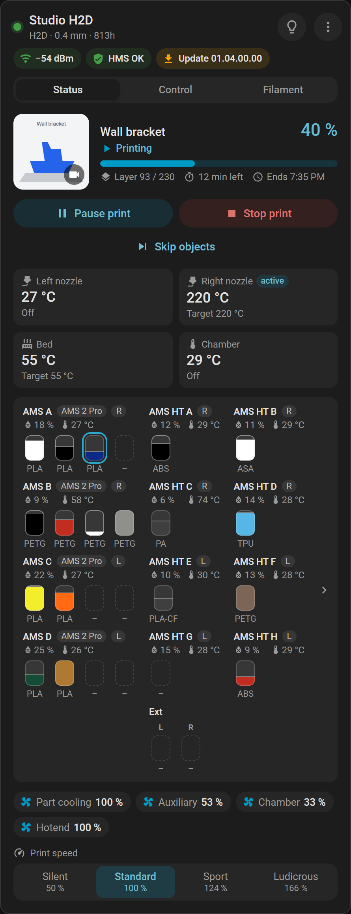

# Printers

What each Bambu Lab model has in Home Assistant, and which entities depend on it.

[← Documentation](README.md)

**On this page:** [Models to know](#models-to-know) · [Hardware](#hardware-at-a-glance) · [Chamber](#chamber) · [Fans](#fans) · [Temperature limits](#temperature-limits) · [Camera](#camera) · [AI detection](#ai-detection) · [Drying](#drying-from-home-assistant) · [AMS units](#ams-units-per-printer) · [Firmware and BamBuddy's report](#what-depends-on-firmware-or-on-bambuddys-report) · [Model codes](#model-codes)

The integration knows some things by the model. Others it learns from what BamBuddy reports: these columns say *reported*, and they tell what BamBuddy says, not what a printer can do.

"H2 series" means the H2S, H2D, H2D Pro and H2C; "X1 series" the X1, X1C and X1E; "P1 series" the P1P and P1S; "A series" the A1 mini, A1 and A2L.

## Models to know

- **P2S:** it has no chamber heater. Its chamber row reads **Keep warm**: the airduct's heating mode keeps the warmth in. With the External Exhaust Fan kit it gets an exhaust fan, and ventilation runs that too ([Per model](chamber.md#per-model)). It starts drying from firmware 01.02.00.00.
- **H2D Pro:** on BamBuddy 1.2.5.7 it has no *Chamber temperature* or *Chamber target temperature*, and its chamber row reads **Keep warm**. BamBuddy 1.3.0 reports them ([Known limitations](troubleshooting.md#known-limitations)).
- **X1E:** on BamBuddy 1.2.5.7 it has no *Chamber target temperature*. From BamBuddy 1.3.0 the target takes up to 60 °C.
- **H3C:** nine tools on one toolhead and an [AMS 3H](glossary.md#ams-3h) with nine slots, which dries two of them. It needs BamBuddy 1.3.1. Each tool has its own external input: *External 1* to *External 9*. While the printer does not detect its AMS 3H, it shows the AMS 3H's spools there, and so does the card. Beside a detected AMS 3H the card shows no input: they may still hold what they showed before, and each slot takes the settings of the tool it feeds; the 2.85 mm TPU tool's slot shows the spool of its input, where the printer reports a spool loaded through the bypass feed. Its *Exhaust fan* on the back wall runs the ventilation, as on the H2 series. The nine tools, *PrintTool 1* to *PrintTool 9*, show their nozzle and print time: [Dashboard card](dashboard-card.md#printtools) and [Entities](entities.md).
- **The A series (A1 mini, A1, A2L):** open frames, so no door sensor, chamber values or airduct. The camera is a chamber image at 5 frames a second at most, and the build plate detection knows the position only. The A1 and the A1 mini dry only from the printer's screen.

## Hardware at a glance

| Model | Door sensor | Light entity | Network | Storage entity | Two nozzles *(reported)* |
|---|---|---|---|---|---|
| A1 mini, A1, A2L, P1P | no | Light | Wi-Fi only | SD card | no |
| P1S | no | Chamber light | Wi-Fi only | SD card | no |
| X1, X1C | yes | Chamber light | Wi-Fi only | SD card | no |
| X1E | yes | Chamber light | Ethernet port | SD card | no |
| P2S, H2S | yes | Chamber light | Wi-Fi only | USB drive | no |
| X2D, H2D, H2C | yes | Chamber light | Wi-Fi only | USB drive | yes |
| H2D Pro | yes | Chamber light | Ethernet port | USB drive | yes |
| H3C | yes | Chamber light | Wi-Fi only | USB drive | no |

- **The A1 mini, A1, A2L and P1P** are [open frames](glossary.md#open-frame); the others are enclosed.
- **Two nozzles** give left and right versions of the nozzle and external spool entities.
- **Only a printer with an Ethernet port** gets *Wired network*. *Wi-Fi signal* is disabled at first on a printer that is on a cable when it is set up, and unavailable while it is on one.

## Chamber

| Model | [Airduct](glossary.md#airduct) | Chamber temperature *(reported)* | Chamber heater *(reported)* |
|---|---|---|---|
| A1 mini, A1, A2L, P1P, P1S | no | no | no |
| P2S | yes | yes | no |
| X1, X1C | no | yes | no |
| X1E | no | yes | from BamBuddy 1.3.0 |
| X2D, H2S, H2D, H2C | yes | yes | yes |
| H2D Pro | yes | from BamBuddy 1.3.0 | from BamBuddy 1.3.0 |
| H3C | yes | yes | yes |

- **An airduct** brings the *Airduct mode* select and the *Ventilation* fan. Which fans it runs: [Per model](chamber.md#per-model).
- **Chamber temperature** exists only if BamBuddy reports a value at setup, **Chamber target temperature** only if it reports a heater. Should either come later, the entry reloads once by itself.

## Fans

| Model | Part cooling fan | Auxiliary fan | Left auxiliary fan | Right auxiliary fan | Chamber fan | Exhaust fan |
|---|---|---|---|---|---|---|
| A1 mini, A1, A2L | yes | no | no | no | no | no |
| P1P | yes | disabled at first | no | no | disabled at first | no |
| P1S, X1C, X1E | yes | yes | no | no | yes | no |
| X1 | yes | disabled at first | no | no | yes | no |
| P2S | yes | yes | if reported | no | no | if reported |
| X2D | yes | no | yes | if reported | no | yes |
| H2S, H2D, H2D Pro, H2C | yes | yes | no | no | no | yes |
| H3C | yes | yes | if reported | no | no | yes |

- **Fan speeds** are in %, settable, in steps of 10 as Bambu's apps show them.
- **Disabled at first:** the stock X1 has no [auxiliary fan](glossary.md#auxiliary-fan), and the P1P neither that nor a chamber fan. Kits add them and BamBuddy cannot tell, so the entities exist, disabled ([turn one on](entities.md#disabled-entities)).
- **If reported:** the entity comes once BamBuddy reports the fan, a moment after it connects. On the P2S that is the External Exhaust Fan kit, or the left auxiliary fan as an accessory.
- **The left auxiliary fan** column shows the known cases: built into the X2D, an accessory on the P2S.
- **The X2D** has a left and a right auxiliary fan, and no plain *Auxiliary fan*.
- **The base P2S** has neither a chamber fan nor an exhaust fan.

Every printer also has the sensor *Hotend fan*, which shows a speed and sets nothing.

## Temperature limits

The target entities take these values, in °C. Their lowest value (0 °C, 32 °F) turns the heater off, and a running job may set them again.

| Model | Nozzle: model reaches | Nozzle: target takes | Bed: model reaches | Bed: target takes | Chamber: target takes *(reported)* |
|---|---|---|---|---|---|
| A1 mini, A2L | 300 | 300 | 80 | 80 | no target |
| A1, P1P, P1S | 300 | 300 | 100 | 100 | no target |
| P2S | 300 | 300 | 110 | 110 | no target |
| X1, X1C | 300 | 300 | 120 | 120 | no target |
| X1E | 320 | 320 | 110 | 110 | 60 |
| X2D | 300 | 300 | 120 | 120 | 65 |
| H2S, H2D, H2D Pro, H2C, H3C | 350 | 320 | 120 | 120 | 65 |

- **The H2 series and the H3C** reach 350 °C, but the target stops at 320 °C. That is BamBuddy's limit: nozzle 320 °C, bed 140 °C, chamber 65 °C.
- **The X1 and X1C bed:** 110 °C on 220 V, 120 °C on 110 V. The table holds the higher value, so no printer is refused what it reaches.
- **The chamber column** needs a reported heater: the X1E and the H2D Pro only from BamBuddy 1.3.0.

## Camera

| Model | Most frames a second | What BamBuddy streams | *Camera frame rate* entity |
|---|---|---|---|
| A1 mini, A1, A2L, P1P, P1S | 5 | chamber image | no |
| P2S, X1, X1C, X1E, X2D, H2S, H2D, H2D Pro, H2C, H3C | 30 | camera stream | yes |

- ***Camera frame rate*** goes from 5 up, in steps of 5. More: [Camera](dashboard-card.md#camera).
- **An external camera** set in BamBuddy's printer settings gives 15 on every model, so an A1 with one gets the entity too.
- **Measured:** an A1 and an A1 mini send the chamber image at about 0.47 frames a second, whatever is asked.

## AI detection

The printer's own detection, not BamBuddy's. Each is a switch the model has or does not have.

| Model | AI print monitoring | First layer inspection | Build plate detection | Spaghetti detection | Purge chute pile-up detection | Nozzle clumping detection | Air printing detection |
|---|---|---|---|---|---|---|---|
| A1 mini, A1, A2L | no | no | position only | no | no | no | no |
| P1P, P1S | no | no | no | no | no | no | no |
| X1, X1C, X1E | yes | yes | position only | no | no | no | no |
| P2S, X2D, H2S, H3C | no | no | yes | yes | yes | yes | no |
| H2D, H2D Pro, H2C | no | no | yes | yes | yes | yes | yes |
| H2D before firmware 01.01.02.08 | yes | no | yes | no | no | no | no |

- ***position only*** is the entity *Build plate position detection*, *yes* in that column *Build plate detection*.
- **The P1P and P1S have none,** so the card shows no print options for them.
- **An H2D of unknown firmware** counts as a current one.
- **The H3C's nozzle clumping detection** is taken from Bambu's list of its features; Bambu Studio names no clump calibration for it.
- **Sensitivity:** where a detection has one (AI print monitoring and the spaghetti, purge chute pile-up, nozzle clumping and air printing detection), it stays as set on the printer. The build plate and first layer checks are on or off only.

## Drying from Home Assistant

For an [AMS 2 Pro](glossary.md#ams-2-pro), [AMS HT](glossary.md#ams-ht) or [AMS 3H](glossary.md#ams-3h) on the printer. How to dry: [Dry filament](ams-and-filament.md#dry-filament).

| Model | Starts drying from Home Assistant *(reported)* |
|---|---|
| A1 mini, A1, P1P, P1S | No: only from the printer's screen |
| A2L | On any firmware; during a print from 01.01.00.00 |
| P2S, H2S, H2C | From firmware 01.02.00.00, also during a print |
| X1 | From firmware 01.09.00.00; not during a print |
| X1C | From firmware 01.09.00.00; during a print from 01.11.02.00 |
| X1E | On any firmware; not during a print |
| X2D | On any firmware; during a print from 01.01.00.00 |
| H2D | From firmware 01.02.30.00; during a print from 01.03.00.00 |
| H2D Pro | On any firmware; during a print from 01.02.00.00 |
| H3C | On any firmware; not during a print |

- **On any firmware** means BamBuddy names no minimum firmware.
- **During a print** is what BamBuddy reports by firmware. A printer that cannot dry during a print refuses, and the integration says so.
- **These are BamBuddy's numbers.** Bambu's [drying page](https://wiki.bambulab.com/en/ams-2-pro/manual/drying-function) lists fewer printers.

## AMS units per printer

These are the printers' limits, not the integration's: it shows the units BamBuddy reports.

| Printer | AMS units |
|---|---|
| H2 series, X2D | 4 AMS 2 Pro + 8 AMS HT |
| P2S | 4 AMS 2 Pro + 4 AMS HT |
| X1 series, P1 series | 4 in all |
| A1, A1 mini | 4 in all (AMS, AMS 2 Pro, AMS HT; firmware 01.07.00.00 and Bambu's A1 series AMS hub), or one AMS Lite on its own |
| A2L | 4 AMS and one AMS Lite |
| H3C | its AMS 3H |

Source: Bambu's [AMS compatibility guide](https://wiki.bambulab.com/en/ams/manual/multi-model-AMS-compatibility-guide).

An AMS HT has [one slot](entities.md#ams-units), an AMS 3H nine, the others four.

## What depends on firmware or on BamBuddy's report

| What | Depends on |
|---|---|
| Two nozzles | BamBuddy's report |
| Chamber temperature | BamBuddy's report at setup; the H2D Pro's from BamBuddy 1.3.0 |
| Chamber heater | BamBuddy's report; the H2D Pro's and X1E's from BamBuddy 1.3.0 |
| P2S exhaust fan | BamBuddy's report of the kit, a moment after it connects |
| Left auxiliary fan (X2D: right) | BamBuddy's report, a moment after it connects |
| AI detection of an H2D | Firmware 01.01.02.08 |
| Starting drying | BamBuddy's report, by firmware |
| Camera rate | An external camera set in BamBuddy |
| AMS filament backup state | BamBuddy's report; unknown on the A1 and P1 series before BamBuddy 1.3.0 |

**A printer without a model:** BamBuddy has none stored, so it gets only what every printer has. That means no door, airduct, storage or auxiliary fan entities, no AI detection, and a camera at 5 frames a second at most. To mend it: [A printer has only a few entities](troubleshooting.md#a-printer-has-only-a-few-entities-and-its-name-shows-no-model).

## Model codes

BamBuddy may store a printer under a code. Device names then say the model, and the printer gets that model's entities. Under `BL-P002` and `BL-P003` BamBuddy treats the camera as a chamber image (5 frames a second, no *Camera frame rate*), and the *reported* columns follow what BamBuddy reports for that code.

| Model | Codes |
|---|---|
| A1 mini | `A12`, `N1`, `A04` |
| A1 | `A11`, `N2S` |
| A2L | `N9` |
| P1P | `C11` |
| P1S | `C12` |
| P2S | `N7` |
| X1 | `BL-P002` |
| X1C | `BL-P001` |
| X1E | `BL-P003`, `C13` |
| X2D | `N6` |
| H2S | `O1S` |
| H2D | `O1D` |
| H2D Pro | `O1E`, `O2D` |
| H2C | `O1C`, `O1C2` |
| H3C | `N10` |

## See also

- [Chamber](chamber.md)
- [AMS and filament](ams-and-filament.md)
- [Entities](entities.md)
