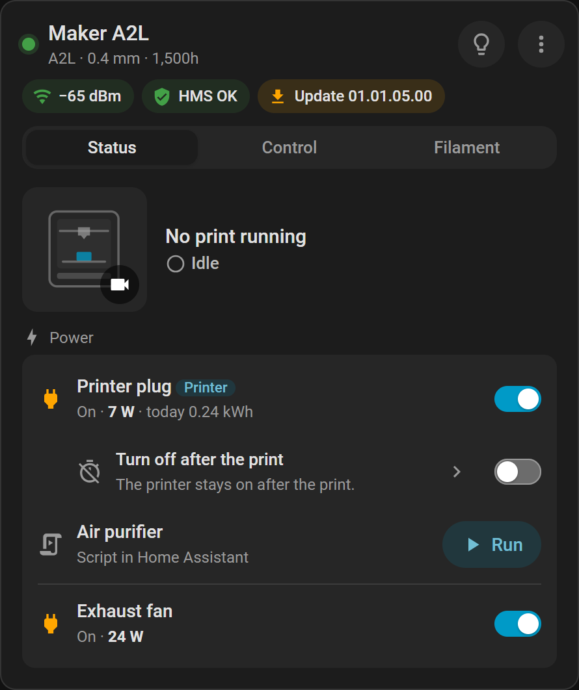

# Smart plugs

Switch the smart plugs BamBuddy links to a printer, see their power, and turn the printer off after a print.

[← Documentation](README.md)

**Needs:** plugs added and set up in [BamBuddy](glossary.md#bambuddy). Home Assistant switches them only.

## How a plug is known

Each plug BamBuddy links to a printer is a device under that printer, named after the printer and the plug, such as *Workshop Exhaust fan (Smart Plug)*. Moved to another printer in BamBuddy, it follows.

**A Tasmota plug is known by its IP address,** the only thing BamBuddy knows it by. If that address changes, for example through DHCP, the plug gets new entities and entity IDs, and its device stays. So give it a fixed address.

Its entities belong to what it switches:

| Plug | Known by |
|---|---|
| Tasmota | Its IP address |
| Home Assistant | Its entity |
| MQTT | Its topic and the path BamBuddy reads there |
| REST | The plug in BamBuddy |

What happens when it changes in BamBuddy:

- **Pointed at another device:** the plug keeps its device and gets new entities.
- **Two plugs swapped:** they keep their devices and swap their entities, with their history.
- **Deleted, or linked to no printer set up here:** its device goes within a minute, and its entities with it, unless another plug switches the same device. That plug then takes them over.

The switch-off after the print stays with its printer either way.

Entities that go keep their recorded history until the recorder purges it. Their statistics are deleted once their entity ID has been unused for 10 days.

The entities are listed under [Smart plugs](entities.md#smart-plugs).

## In the card

The Status tab's section **Power** shows the plugs, with the printer's own first, tagged **Printer**. The chip `power` shows the same in a dialog; add it with `header_chips`.

- **The printer's own plug** always shows. Where several power the printer, it is the one BamBuddy picks: one that switches, enabled, on its printer card, reporting power, then the lowest number.
- **Other plugs** show as BamBuddy's setting for its printer card says.
- **Figures:** the state, then the power and today's energy, where the plug reports them.

| Kind of plug | In the card |
|---|---|
| A plug that switches | A switch |
| A Home Assistant script | **Run**; it has no on and off |
| An MQTT plug BamBuddy only watches | *Display only*, with its figures |

A plug BamBuddy gets no answer from reads *Not reachable* and has no switch. A plug that does not report its state reads *State unknown*, with **Turn on** and **Turn off** buttons in place of the switch.

While the printer's plug is off, the card says so and offers **Turn on the printer**, then counts while it starts. See [Offline](dashboard-card.md#offline).

### Every off asks

| The plug | The card asks |
|---|---|
| An accessory | **Turn off "…"?** Everything plugged into it loses power |
| The printer's, while idle | **Turn off the printer?** It also warns of a hot nozzle: its fan stops too |
| The printer's, during a print | **Stop the print and turn off?** In red |
| The printer's, while offline | **Turn off the printer?** BamBuddy cannot say whether it prints; the card judges by the plug's power |

## Turn off after the print

BamBuddy's own *Auto Off* cannot be changed with an API key, so the integration brings its own. It works for the printer's own plug.

### Set it up

1. In the section **Power**, turn on **Turn off after the print**.
2. Tap the row to set the rest.
3. Choose **Turn off once the nozzle is cooler than**: 50 °C unless set, from 30 to 100 °C.
4. Choose **When**: **Only after the next print** (the default) or **After every print**.

The entities *Turn off after the print*, *Repeat after every print* and *Turn off when nozzle is below* do the same, also without a card. The option `show_auto_off` only hides the row.

### When it turns off

After a print that finished, it waits until all of this holds:

- the printer stands still
- the AMS neither changes filament nor dries
- no heater has a target
- every nozzle is below the set temperature

It reads the printer once more, then turns the plug off.

It never acts during a running or paused print, or on a printer BamBuddy cannot reach. While it waits, **Don't turn off this time** keeps the printer on.

- **Failed or stopped print:** the printer stays on.
- **After two hours** it gives up, whatever it still waits for.
- **A print that ends unseen** leaves the plug on: while Home Assistant is not running, or while BamBuddy has lost the printer.
- **Only after the next print:** that print uses it up, however it ends; a failed print too, which leaves the printer on.

While BamBuddy's own *Auto Off* is on for the plug, Home Assistant's cannot be turned on: turn BamBuddy's off first, so the two never act at once.

### Where it stands

The switch's attribute `phase`:

| `phase` | Meaning |
|---|---|
| `idle` | Nothing pending |
| `waiting` | A print finished; it waits to turn off |
| `done` | It turned the plug off, or the plug went off meanwhile |
| `skipped` | **Don't turn off this time** was pressed |
| `failed_print` | The print failed or was stopped |
| `gave_up` | Within two hours, the printer was not ready or the plug did not answer |
| `plug_failed` | The plug did not take the command for ten minutes |
| `bambuddy` | BamBuddy's own *Auto Off* is on for the plug |

While it waits, `waiting_for` says for what:

| `waiting_for` | It waits for |
|---|---|
| `nozzle` | The nozzle to cool |
| `drying` | The AMS to finish drying |
| `filament` | The AMS to finish a filament change |
| `heating` | A target temperature to go |
| `printer` | BamBuddy to reach the printer |
| `plug` | The plug to answer |

In the logbook the plug turns off, and this switch with it where it was on only for the next print.

To react to the switch-off, use a state trigger on the switch's `phase` from `waiting` to `done`. Without `from`, it fires again when the integration reloads. `done` lasts until the plug is on again a minute or more later, a print starts, or this switch is turned on or off.

## Off during a print

Home Assistant does not refuse a plug's off during a print: the plug is an emergency stop, and only the card asks first. Without power the print stops and cannot be resumed.

Leave a printer's plug out of automations and voice commands that turn everything off.

## See also

- [Smart plug entities](entities.md#smart-plugs)
- [Triggers that do not misfire](automations.md#triggers-that-do-not-misfire)
- [Offline](dashboard-card.md#offline)
