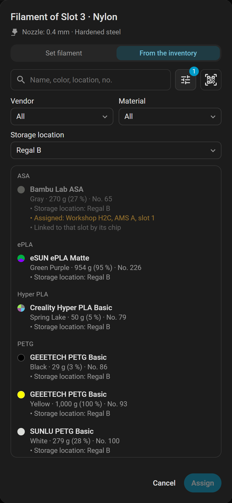

# Spool inventory

Show and assign the spools of BamBuddy's inventory from Home Assistant.

[← Documentation](README.md)

**Needs:** a key with **Manage Inventory** to assign ([which permission opens what](configuration.md#what-each-permission-opens)); without it the card still shows assigned spools.

## Not with Spoolman

The inventory here is BamBuddy's own [spool inventory](glossary.md#spool-inventory). While [Spoolman](glossary.md#spoolman) keeps the spools in BamBuddy, none of this page is available: no assigned spool, no tab, and the actions refuse.

## What the card shows

A slot with a spool from the inventory names it below the slot's filament, with what is left of it, such as *89 % · 886 g*. The filled part of the slot's color follows that figure.

| You see | Meaning |
|---|---|
| The spool's name below the filament | The spool assigned to this slot |
| *Waiting for the spool* | The slot is empty; BamBuddy sets it once the spool is in |

In the slot's ✏️ dialog, the box **Assigned spool from the inventory** shows:

- the spool's name and color
- what is left, and its number in BamBuddy
- its storage location
- **Also assigned:** a warning where BamBuddy holds it in another slot too (rarer from BamBuddy 1.3.0, which takes a spool out of its other slot once its chip is read)

The same figures are attributes of the slot's sensor; see [AMS units](entities.md#ams-units).

## Assign a spool

1. Tap the ✏️ on the slot. An empty slot opens on the list at once.
2. Open the tab **From the inventory**.
3. Choose a spool.
4. Choose **Assign**.

BamBuddy then sets the slot from the spool: its material, color, profile and K value.

- **List:** spools are grouped by material, the slot's own first in its group. Each shows its color, what is left, its number, its storage location and where it is assigned.
- **A spool in another slot** moves: the dialog says so, and it leaves that slot.
- **A slot with a Bambu Lab chip spool** has no tab: BamBuddy links that spool itself.
- **No tab at all:** the key lacks **Manage Inventory**, or the inventory has no spools.
- **During a filament change:** **Assign** waits.

The slot a running print feeds takes a spool too, unless it holds a chip spool. See [Warnings before you assign](#warnings-before-you-assign).

## Filters and search

Both show from five spools on, above the list.

**Filter:** the button beside the search opens **Vendor**, **Material** and **Storage location**. The last shows only where a spool has one.

The filters narrow each other: a vendor leaves its materials, a material its vendors. The search leaves the filters as they are.

**Search:** every word you type must appear in the name, brand, material, color or location. Any order works, and so does part of a word. A word of digits finds the spool with that number, and so do *No. 5* and *#5*.

## Scan a label

**Scan QR**, beside the search, reads the QR code of a spool label printed by BamBuddy. Like the search, it shows from five spools on.

| You use | How it reads |
|---|---|
| The Home Assistant app | The app's own scanner; **Enter the number** types it in instead |
| A browser over HTTPS | The camera, with **Light** where it has one |
| A browser without HTTPS | A photo of the label (**Take photo**) |

The spool then shows alone in the list, chosen: **Assign** assigns it. With the option `assign_scanned_spool` it is assigned at once, unless the dialog warns, the spool is in another slot, or a running print feeds the slot.

| The card says | Meaning |
|---|---|
| Not a BamBuddy spool label | The camera sees a QR code, but no spool label |
| BamBuddy has no spool No. … | The label's spool is not in the inventory |
| No QR code could be read in the picture. | Take the photo again, closer or sharper |
| The browser did not allow the camera. | It offers a photo instead, as it does without a camera |

## Why a spool is grayed out

A spool that cannot go into this slot stays in the list, grayed out, with the reason.

| The list says | Why | What to do |
|---|---|---|
| Not suitable for the AMS | Its filament may not go into an AMS | Use an external spool |
| Not suitable for this nozzle | Its filament does not fit the nozzle that feeds the slot | Use a slot on the other nozzle, or change the nozzle |
| Not suitable for this printer | Bambu Studio does not offer its filament here | Use another printer |
| Linked to that slot by its chip | A Bambu Lab spool with its chip, read in another slot | Move the spool itself |
| Locked while … is printing. | It sits in a slot of another printer that prints, or whose print is paused | Wait, or change the assignment there |

Only a chip spool in another slot is locked: one on the shelf can be chosen, and so can a spool with an NFC tag. The rules are [Bambu Studio's](ams-and-filament.md#why-a-filament-is-not-in-the-list). An archived spool does not show in the list.

## Warnings before you assign

Above the buttons, the dialog says what a step will change:

| The dialog says | When |
|---|---|
| The spool is PETG, the slot is set to PLA. Assigning sets the slot to PETG. | The materials differ |
| … is printing from this slot (PLA). Assigning switches it to PETG mid-print. | The same, in the slot a print feeds |
| … is printing from this slot. Assigning changes it mid-print. | The same material, in the slot a print feeds |
| Assigning takes the spool out of AMS A, slot 2. | The spool sits in another slot |

BamBuddy keeps an assignment only while the slot matches the spool. So in the tab **Set filament** the dialog warns before you change it:

| The dialog says | When |
|---|---|
| Setting this ends the assignment of …. | The new color or type no longer matches the spool |

Another color or another type (for example PETG instead of PLA) ends the assignment. A very close color does not. Resetting the slot ends it too.

## Remove an assignment

**Remove assignment** is in the box of the assigned spool, on the tab **From the inventory**. It acts at once. A chip spool has none: BamBuddy links it by its chip.

It removes only the link in BamBuddy, and nothing goes to the printer, so it also works during a print. While the printer is offline the card has no ✏️, but [`bambuddy.unassign_spool`](actions.md#bambuddyunassign_spool) still removes the link. The slot keeps its filament.

BamBuddy 1.3.0 also removes an assignment by itself: when the spool is archived, or when its AMS stays unplugged for two minutes.

## See also

- [AMS and filament](ams-and-filament.md)
- [`bambuddy.get_spools`](actions.md#bambuddyget_spools)
- [AMS units](entities.md#ams-units)
